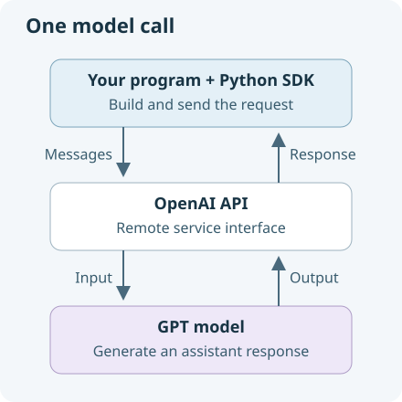

# Make your first model call

**9 minutes.** We will start by asking a model to write FizzBuzz. Before connecting the code, let's separate three things that are easy to mix up.

## The model, the API and the SDK

An **LLM**, or **large language model**, is trained on large amounts of text, including code, to generate responses to input. That training gives it patterns and knowledge it can use to answer questions, explain code and suggest changes. Its responses can vary, and useful-looking code still needs checking.

We will use an **OpenAI GPT model**. The starter selects `gpt-5`; your instructor may have configured another model through `AGENT_MODEL`.

| Part | Its job in this exercise |
| --- | --- |
| Model | Generates an assistant response from the messages we send. |
| API | The remote service interface our program calls to request that response. |
| Python SDK | OpenAI's Python library, which handles the HTTP request and gives us a Python response object. |



Your instructor provides the API access for this workshop: the **key** authorizes requests, and the **endpoint** is the service address. The supplied client reads those values from its environment configuration. You do not need to edit `.env` for this exercise.

We use text messages here, although models can support other input and output types. Sending a request uses the trained model; it does not retrain its weights.

## One file, one program

Throughout this workshop you will edit **agent.py**. The supplied **main.py** imports your functions and runs the terminal session. Start the same program after each saved change:

```bash
uv run python main.py
```

The supplied terminal asks for your question. Try this:

```text
Write a Python function that returns FizzBuzz for integers 1 to 15.
```

The starter tells you `Implement ask in agent.py` and returns to the shell. That is the missing connection you will build now. No model reply has been substituted.

## Connect the request

Open **agent.py**. Complete `ask(client, messages, tool_schemas)`: send `MODEL` and the supplied `messages` to `client.chat.completions.create`, then return `response.choices[0].message`.

The terminal already builds a user message from what you type. `user` is your input; `assistant` is the model's reply; a `system` message supplies instructions. Keep the **whole assistant message**, because later it can contain requested tool calls as well as `.content` text.

We build outgoing user and tool messages as ordinary dictionaries, accessed with keys such as `message["content"]`. The SDK returns the assistant message as an object, accessed with attributes such as `assistant_message.content` and `assistant_message.tool_calls`. The SDK accepts both forms in the next request, so we can keep the returned object in our history.

`ui.show_request` displays the messages' count and roles; the `with` block shows a spinner while the API call runs. Both are supplied display helpers. The SDK request itself is visible in your function.

The empty `TOOL_SCHEMAS` list means we are asking for text. This list holds descriptions of tools, not the Python functions themselves. The SDK names its request argument `tools`; our variable is named `tool_schemas` to make the distinction clear. The supplied `options` line in our answer omits an empty tools argument; later, the same request can advertise available functions.

<details>
<summary>Copyable solution — replace the whole ask function</summary>

```python
def ask(client: Any, messages: list[Any], tool_schemas: list[dict[str, Any]]) -> Any:
    # An empty schema list is omitted: the first lesson is a text-only request.
    options = {"tools": tool_schemas} if tool_schemas else {}
    ui.show_request(messages)
    with ui.console.status("Thinking…", spinner="dots"):
        response = client.chat.completions.create(
            model=MODEL, messages=messages, **options,
        )
    return response.choices[0].message
```

</details>

Save with **Ctrl/Cmd+S**, start the same command again, and ask the FizzBuzz question. The request preview shows the count and roles of the messages sent; the **Answer** panel shows what the model returned. The preview is supplied tracing, not a simulated model reply.

```bash
uv run python main.py
```

Does the generated code check multiples of both 3 and 5 correctly? It is text in a response; your program has not executed it.

An **agent** adds a **harness**: our program supplies context, executes tools and decides when to ask the model again. You will grow this same program one capability at a time. `main.py` handles the terminal and connection setup; `ui.py` handles display. Your learning work stays in **agent.py**.

**Predict:** if you now ask “Now change it to stop at 20”, will the next request include the earlier code? Keep this chat open for the next lesson.

<details>
<summary>Which part generated the answer?</summary>

The GPT model generated the response. The API returned it, the SDK exposed the message as a Python object, and our terminal displayed its text. A plausible answer still needs checking.

</details>

For authentication or connection failures, show your instructor the error. Do not paste credentials into chat.

<details>
<summary>Catch up if needed</summary>

Save your attempt separately first. After typing `exit` to leave the chat, this copies the complete learner file **through this lesson**, including the earlier exercises:

```bash
cp solutions/steps/01-model.py agent.py
```

Restart with `uv run python main.py`. Refresh the open editor file after copying, before saving over it. This is an explicit replacement of your work, not an automatic fallback.

</details>
